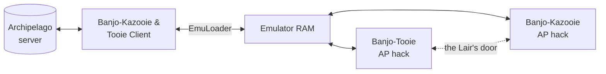

<p align="center">
  
</p>

<p align="center">
  <a href="https://github.com/kegan-dev/Archipelago-BanjoKazooieTooie/releases"></a>
  <a href="https://archipelago.gg"></a>
  
  <a href="https://github.com/kegan-dev/Archipelago-BanjoKazooieTooie/actions/workflows/tests.yml"></a>
  <a href="LICENSE"></a>
</p>

**Banjo-Kazooie and Banjo-Tooie in one [Archipelago](https://archipelago.gg) slot, on one ROM.** Walk into the
entrance of Gruntilda's Lair in Banjo-Tooie's Spiral Mountain and the console saves, switches games behind a black
screen, and drops you into Banjo-Kazooie's Lair. Walk back out and you're in Tooie again. Both games' checks are in
one slot, and the moves the two games share are one item each, learned in both.

## How it plays

- **The Lair's door is the hub.** Tooie's Spiral Mountain leads to the Isle o' Hags as usual, and to Banjo-Kazooie
  through the Lair. Each Tooie save file has its own Banjo-Kazooie save, tied to it.
- **Shared moves.** 17 of Banjo-Kazooie's 18 moves are the same item as Tooie's (Swim is Dive, Feathery Flap is
  Flutter, Flight is Flight Pad, and so on), and Tooie's progressive moves teach both games. One setting,
  `randomize_bk_moves`, decides which moves you start with.
- **Pick your goal**: Tooie's victory condition, beating Gruntilda in Banjo-Kazooie, or both.
- **Doors across the games** (`cross_game_world_entrances`): Banjo-Kazooie's nine Lair doors and Tooie's world
  entrances shuffled together, so a door in Gruntilda's Lair can lead into a Tooie world and back.
- **Traps, egg and feather nests, death link and tag link** hit whichever game you're playing when they arrive.
- **Cheato** moves to King Jingaling's throne room in Jinjo Village, since his old spot is where the door is.
- Banjo-Kazooie's jiggies, Mumbo tokens and honeycombs are "Lair Jiggy", "Lair Mumbo Token" and "Lair Empty
  Honeycomb", so you can tell them from Tooie's.

The settings are Tooie's, as in [Banjo-Tooie AP](https://github.com/jjjj12212/Archipelago-BanjoTooie), plus
Banjo-Kazooie's from the [Banjo-Kazooie world](https://github.com/kegan-dev/Archipelago-BanjoKazooie) with `bk_` in
front. Death link, tag link and traps use Tooie's settings, for both games.

## Playing

You need Archipelago 0.6.7 or newer, your own **Banjo-Kazooie (USA) v1.0** and **Banjo-Tooie (USA)** ROMs (`.z64`,
`.v64` or `.n64`), and Project64 3.0.1 or ares v148.

1. Download `banjo_kazooie_tooie.apworld` and the template yaml from the
   [latest release](https://github.com/kegan-dev/Archipelago-BanjoKazooieTooie/releases), and double-click the
   `.apworld` to install it. It needs no other world: it carries the Banjo-Kazooie world and Banjo-Tooie AP V4.13.1,
   and either can be installed beside it, Banjo-Tooie AP at any version.
2. Put your name in the yaml and give it to whoever is hosting.
3. Start the **Banjo-Kazooie & Tooie Client** from the Archipelago Launcher. The first time, it asks for both ROMs
   and makes `Banjo-Kazooie & Tooie AP <version>.z64` from them.
4. Connect, open that ROM in your emulator, and start a new Tooie file. Keep the client connected while you play.

The [setup guide](worlds/banjo_kazooie_tooie/docs/setup_en.md) has the details, and the [alpha guide](docs/ALPHA.md)
covers what's different from the original games, the known issues, and what to send when something breaks.

### Where it's been played

| | Status |
|---|---|
| Project64 3.0.1 (Windows) | Played through the alpha's tests |
| ares v148 (Windows) | Played through the alpha's tests |
| Other emulators, Everdrive, console | Not tried yet: reports welcome |

## How it works



The ROM is a 64 MiB [dual-boot image](https://github.com/kegan-dev/AP-Banjo-Kazooie-Tooie): Banjo-Tooie with its
Archipelago hack, and Banjo-Kazooie with its own, built from the decompilation. Only one game runs at a time; at a
door the running game saves and starts the other, which comes up straight at the destination. The client watches
which game is running: while Tooie runs it is the stock Banjo-Tooie AP client, while Banjo-Kazooie runs it is the
Banjo-Kazooie client, and it gives each game its share of what the server sends.

The apworld carries patches with only the hacks' changes, and the client applies them to your ROMs. No game data is
in this repository or its releases.

## The Banjo repositories

| Repository | What it is |
|---|---|
| [Archipelago-BanjoKazooie](https://github.com/kegan-dev/Archipelago-BanjoKazooie) | The Banjo-Kazooie world and its client |
| **Archipelago-BanjoKazooieTooie** | This world: both games in one slot, and its client |
| [AP-Banjo-Kazooie-Tooie](https://github.com/kegan-dev/AP-Banjo-Kazooie-Tooie) | The dual-boot image: both games on one cartridge image |
| [AP-Banjo-Kazooie](https://github.com/kegan-dev/AP-Banjo-Kazooie) | The Banjo-Kazooie ROM hack, a fork of the decompilation |
| [AP-Banjo-Tooie](https://github.com/kegan-dev/AP-Banjo-Tooie) | The Banjo-Tooie ROM hack, a fork of the Banjo-Tooie AP hack |

## Development

The world is in `worlds/banjo_kazooie_tooie/`. It subclasses the Banjo-Tooie world and layers the Banjo-Kazooie world
in, so a checkout to test it needs all three worlds:

```bash
git clone --branch 0.6.8 https://github.com/ArchipelagoMW/Archipelago.git
git clone https://github.com/kegan-dev/Archipelago-BanjoKazooie.git
git clone --branch V4.13.1 https://github.com/jjjj12212/Archipelago-BanjoTooie.git
cd Archipelago
python -m venv .venv && .venv/bin/pip install -r ci-requirements.txt   # Windows: .venv\Scripts\pip
ln -s "$PWD/../Archipelago-BanjoKazooie/worlds/banjo_kazooie" worlds/banjo_kazooie   # Windows: mklink /J
ln -s "$PWD/../Archipelago-BanjoTooie/worlds/banjo_tooie" worlds/banjo_tooie
ln -s "$PWD/../Archipelago-BanjoKazooieTooie/worlds/banjo_kazooie_tooie" worlds/banjo_kazooie_tooie
.venv/bin/python ModuleUpdate.py --yes
.venv/bin/python -m pytest worlds/banjo_kazooie_tooie
```

The released `.apworld` carries copies of the two worlds it builds on; in a checkout it reads them from
`worlds/banjo_kazooie` and `worlds/banjo_tooie`, and its code reaches them only as its subpackages `bk` and `bt`.
The tests that need the retail ROMs look in a `roms/` folder at this repository's root (git-ignored), or in the folder
`BKBT_ROMS` names, and are skipped without them.

Issues and pull requests are welcome. This repository is published from a development repository, so a merged pull
request lands there first and comes back here with the next release.

## Credits

- [jjjj12212, g0goTBC and Auztin](https://github.com/jjjj12212/Archipelago-BanjoTooie) for Banjo-Tooie AP. This
  world is built on their world (MIT), and the image's Tooie on Auztin's
  [ROM hack](https://github.com/Auztin/AP-Banjo-Tooie) (MIT).
- The [Banjo-Kazooie decompilation](https://gitlab.com/banjo.decomp/banjo-kazooie) project, which Banjo-Kazooie's hack
  is built on.
- [HarbourMasters' Lighthouse](https://github.com/HarbourMasters/Lighthouse), for Banjo-Kazooie's logic (CC0).
- [Killklli's EmuLoader](https://github.com/Killklli/EmuLoader) (MIT), which the client reaches the emulator with.
- [Archipelago](https://archipelago.gg) and its community.

## Licence

[MIT](LICENSE). The worlds the release carries keep their own licences, Banjo-Tooie AP's MIT licence among them.
Banjo-Kazooie and Banjo-Tooie are trademarks of their owners; this project isn't affiliated with them. Bring your own
legally obtained ROMs.
